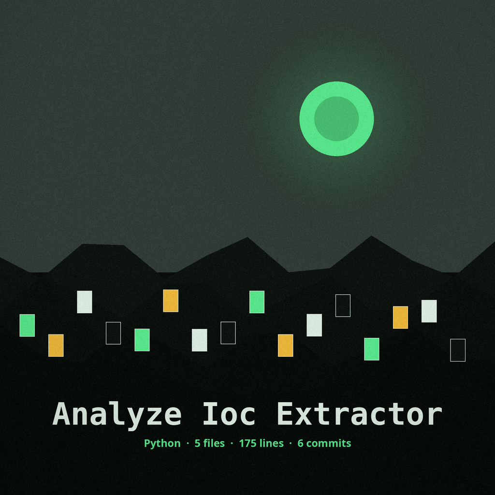

# analyze-ioc-extractor


<p align="center"></p>


Extracts Indicators of Compromise (IOCs) such as IP addresses, URLs, and email addresses from a text file or standard input, using regular expressions.

## Install
```sh
git clone https://github.com/ShadowGuard-AI/analyze-ioc-extractor
cd analyze-ioc-extractor
pip install -r requirements.txt
```


## Usage
```sh
python3 main.py [INPUT] [-o OUTPUT] [-i IOC_TYPE] [-v] [-q]
```


## Parameters
- `INPUT`: input file, or `-` for stdin. Default: stdin.
- `-h`: show help message and exit.
- `-o`, `--output`: output file in CSV format.
- `-i`, `--ioc-type`: type of IOC to extract: `ip`, `url`, `email`, `md5`, `sha1`, `sha256`, `domain`, or `all`. Default: `all`.
- `-v`, `--verbose`: enable verbose output (logging).
- `-q`, `--quiet`: suppress all output except errors.


## Verified behavior
- A sample containing an IP address, a URL, an email address, an MD5 hash, and a domain produced rows for each of those types.
- With `-i ip`, only the IP row was produced.
- With `-o`, the CSV has two columns, `ioc_type` and `ioc_value`.
- Reading from stdin with `-` works.
- A missing input file exits 1.
- Note on the matches: the URL pattern also matches bare domains and bare IP addresses, so a `url` row is a pattern match, not a validated URL.


## License
MIT License, see [LICENSE](LICENSE).

> Counter notice: the URL pattern also matches bare domains and bare IP addresses, so a url row is a pattern match, not a validated URL.
> Counter notice: a missing input file exits with code 1.
